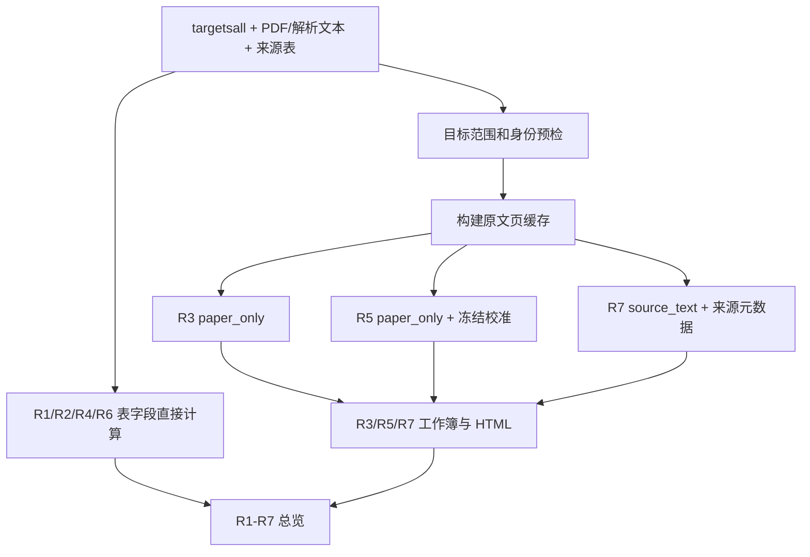
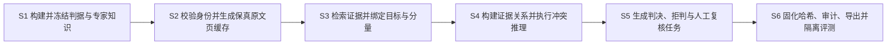

# R3/R5/R7 专家知识冲突检测方法 S1-S6 详细草案

日期：2026-07-14

本文用于把当前可运行项目整理为专利说明书中的方法步骤。本文不是正式法律
意见；最终权利要求仍应由专利代理人结合现有技术检索、申请主体和预期保护范围
调整。文中“优选地”“可选地”表示从属实施方式，不代表当前软件已经实现所有
备选算法。

## 1. 当前完整工作流及边界

当前项目存在三条相互关联但用途不同的主线：

1. `run_latest_workflow.sh` 是面向全部目标的结果生成流程。默认 R3 和 R5 使用
   原文路径，R7 使用 `source_text` 配置；该 R7 配置允许读取 ROCKUNIT 和
   PMAGRESULT 的来源元数据，因此整条流程不能直接声称为“四输入严格模式”。
2. `run_strict_knowledge_workflow.sh` 是建议写入专利核心实施例的严格评分流程。
   在线阶段只允许读取三列身份清单、原文页缓存、冻结专家知识库和冻结规范判据。
3. R3 grouped OOF 流程是开发和评测流程，不是生产评分入口。它在每个外折训练
   区使用标签拟合模型，但同一 REFNO 不跨训练/测试折，且测试时不把 PMAGRESULT、
   当前行 ROCKMAG、旧预测或旧评测作为输入特征。

因此，以下 S1-S6 以第二条严格流程为主，吸收第一条流程的文档生成能力和第三条
流程的隔离评测方法，但不把兼容流程中的来源表访问写入严格在线权利要求。

### 1.1 当前全目标业务流程

执行 `run_latest_workflow.sh` 时，实际顺序如下：

1. 读取 `data/targetsall.xlsx`，并通过 ROCKUNIT 与 PMAGRESULT 校验 RESULTNO、
   ROCKUNITNO、REFNO 和 ROCKNAME 的目标范围与身份一致性；该步骤属于业务数据
   预检，因此整个编排进程不是严格四输入进程。
2. 从 `data/parsed_mds/` 和 `data/raw_pdfs/` 构建按 REFNO 组织的页缓存；默认
   R3 `paper_only` 再生成只含 REFNO、RESULTNO、ROCKNAME 的临时身份清单，并从
   身份与原文页缓存生成 R3 证据关系和判决。
3. 默认 R5 `paper_only` 使用目标身份、原文页缓存和冻结的 REFNO 分组校准产物
   生成 R5；该 R5 评分配置本身不加载 ROCKUNIT/PMAGRESULT，但由完整编排器传入
   路径并在其他阶段使用。
4. 默认 R7 `source_text` 使用原文语义规则，并允许结合 ROCKUNIT/PMAGRESULT
   来源元数据生成 R7；只有 strict workflow 中的 `knowledge_strict` 配置满足
   四输入边界。
5. 将 R3、R5、R7 分别导出为工作簿和 HTML；同时由 PMAGRESULT/ROCKUNIT 直接
   计算 R1、R2、R4、R6，并生成 R1-R7 总览页面。
6. 若目标文件中存在标签列，只在最终工作簿生成后计算正确率、覆盖率和混淆矩阵；
   `targetsall.xlsx` 的常规无标签运行只生成结果，不形成有效准确率评测。



### 1.2 建议写入专利核心实施例的严格流程

严格流程不调用上述目标范围源表校验和 R1/R2/R4/R6 表字段计算。其评分进程只
接收身份清单、原文页缓存、冻结专家知识库和冻结规范判据；R3、R5、R7 在相互
隔离的空目录中评分，写后执行边界审计，预测哈希固定后才允许单独评测。下述
S1-S6 描述的是该流程。



## 2. 参考专利的写法

以下专利用于参考步骤组织、模块镜像和权利要求展开方式，不表示本项目可以照搬
其技术内容，也不表示本项目已经避开其保护范围。

| 公开号 | 可借鉴的撰写结构 | 与本项目的主要区别 |
| --- | --- | --- |
| [CN112528036B](https://patents.google.com/patent/CN112528036B/zh) | 先以步骤1至步骤6概括本体、证据抽取、结构元抽取、关系建立、实体融合和图存储，再用子步骤逐项展开 | 该专利面向司法证据知识图谱，并在冲突时采用投票；本项目强调古地磁目标绑定、可撤销冲突、四值证据态和拒判 |
| [CN116502715A](https://patents.google.com/patent/CN116502715A/zh) | 将非结构化数据转换、实体关系抽取、知识聚合、实体链接和证据链匹配写成连续 S1-S5，并让装置模块与方法步骤一一对应 | 该申请面向电子取证证据链；本项目不把来源片段简单融合成唯一事实，而是保留 SUPPORT 与 CONFLICT 共存 |
| [US10331659B2](https://patents.google.com/patent/US10331659B2/en) | 独立权利要求使用“接收内容、生成图结构、检测概念冲突、响应冲突执行处理”的功能链，并分别覆盖方法、装置和程序产品 | 该专利处理聚合知识库中的同义词/概念分裂；本项目处理原文事实与冻结领域判据之间的目标级冲突 |
| [CN118210983B](https://patents.google.com/patent/CN118210983B/zh) | 以 S1-S6 描述初始化、冲突检测、知识维护、生成、反馈和迭代，并以 S21-S26 细化冲突识别报告与评估报告 | 该专利包含在线知识更新和用户个性化；本项目严格评分期间冻结知识，评测反馈不得回写同一次运行 |
| [CN111680173B](https://patents.google.com/patent/CN111680173B/zh) | 对多来源检索结果执行关联、去重、相互印证、冲突检测和自组织 | 该专利面向跨媒体检索；本项目目前主要处理 PDF/解析文本，并要求每条关系保留页号、引文和哈希 |

从这些文件可归纳出较稳妥的撰写方式：独立权利要求描述必要的数据变换链；从属
权利要求限定输入格式、阈值、作用域、冲突状态、审计字段和具体指标；说明书再
给出算法、公式、异常分支和实施例；装置、设备和存储介质权利要求与方法步骤
保持对应。

## 3. 顶会和权威论文对应关系

不能表述为“每一个模块均来源于顶会论文”。当前技术依据是顶会论文、顶级期刊、
领域论文和标准的组合，并且若干顶会方法只是设计参考，当前代码没有直接部署其
神经模型。

| 技术环节 | 可参考的论文或标准 | 性质及当前实现关系 |
| --- | --- | --- |
| 文档级关系与跨句证据 | [DocRED, ACL 2019](https://aclanthology.org/P19-1074/) | ACL 顶会数据集论文；支持“文档级关系需要跨句推理”的问题定义，当前项目使用规则化作用域和目标绑定，并未部署 DocRED 模型 |
| 候选片段检索 | [Dense Passage Retrieval, EMNLP 2020](https://aclanthology.org/2020.emnlp-main.550/) | EMNLP 顶会论文；可作为语义召回备选，当前正式路径以冻结术语、正则和上下文窗口为主 |
| 长文档表示 | [Big Bird, NeurIPS 2020](https://proceedings.neurips.cc/paper/2020/hash/c8512d142a2d849725f31a9a7a361ab9-Abstract.html) | NeurIPS 顶会论文；说明长序列建模的技术路线，当前生产流程没有使用 BigBird |
| 数据来源追踪 | [Provenance Semirings, PODS 2007](https://doi.org/10.1145/1265530.1265535) | PODS 顶级数据库会议论文；与当前引文、页面、规则、输入和输出哈希的来源链思想相关 |
| 多源冲突与来源依赖 | [Integrating Conflicting Data: The Role of Source Dependence, PVLDB 2009](https://doi.org/10.14778/1687627.1687690) | VLDB/PVLDB 顶级数据库研究；用于界定同源证据不能被重复视为独立支持 |
| 可撤销推理与论证 | Dung 1995、Antoniou 等 2001、Modgil 与 Prakken 2013 | 主要是 Artificial Intelligence、ACM TOCL 等顶级期刊，不是统一意义上的顶会；当前规则状态与其思想相关 |
| 拒判和选择性预测 | [SelectiveNet, ICML 2019](https://proceedings.mlr.press/v97/geifman19a.html)、Chow 1970 | ICML 顶会加经典期刊依据；当前 R3 使用固定双阈值拒判，但不是 SelectiveNet 网络 |
| 时间约束 | Allen 1983、Dechter 等 1991、W3C OWL-Time | 权威期刊和标准；当前用于 R5/R7 时序关系语义，不是顶会模型 |
| 球面统计和古地磁极比较 | Fisher 1953、Heslop 与 Roberts 2020 | 领域权威期刊依据；R7 的角距和 A95 关系属于领域计算，不存在必须对应计算机顶会的要求 |

专利说明书中建议使用“参考现有文档级关系抽取、来源追踪、可撤销推理、选择性
预测和球面统计研究，形成面向古地磁可靠性指标的组合技术方案”，不建议写成
“本发明的每一步均采用顶会最先进算法”。后者既不符合当前代码，也会缩小或
歪曲技术贡献。

## 4. 独立方法权利要求的 S1-S6 概括稿

一种基于原始文献、冻结专家知识和目标绑定证据关系的古地磁可靠性指标知识冲突
检测方法，由至少一个处理器执行，其特征在于，包括：

**S1，构建并冻结判据知识。** 获取古地磁可靠性指标的规范判据和领域术语，
将所述规范判据形式化为支持条件、冲突条件、未知条件和可撤销例外关系，将所述
领域术语组织为记录无关的专家知识库；校验所述规范判据和专家知识库不包含待评
目标的行级答案映射，分别生成版本标识和内容哈希。

**S2，形成目标身份与保真原文数据。** 获取仅含文献标识、结果标识和目标名称
的身份清单，根据文献标识取得对应原始文献；由至少一种文档解析器生成保留物理
页号的页级文本，对存在解析风险的页面调用候选解析器，并依据与评价标签无关的
文本质量、版面质量和领域概念保真条件选择单一页面来源，形成页级原文缓存。

**S3，检索并绑定目标证据。** 根据冻结专家知识库生成指标相关检索表达式，从
页级原文缓存检索候选片段；基于目标全名、目标特异词、同句关系、独占段落、
表格行、同页关系、相邻页关系和同文献竞争目标，确定候选片段与待评目标之间的
作用域和绑定强度；将不能唯一映射到结果标识的候选标记为身份歧义而不强制共享。

**S4，建立证据关系并进行可撤销冲突推理。** 将目标绑定候选转换为带来源信息
的支持关系、冲突关系或未知关系，分别依据 R3 的载磁矿物表征链、R5 的构造与
古水平面控制链以及 R7 的年轻参考极比较链进行规则匹配；解析冲突规则与限定
例外之间的攻击或击败关系，得到活动、被击败或未决的规则实例，并生成保留支持
与冲突并存状态的目标级证据关系图。

**S5，生成判决和复核任务。** 根据活动支持组的完整性、活动冲突的优先级、
来源质量和目标绑定状态，输出支持、反驳、并存或均未建立的证据状态，并进一步
输出满足、不满足或拒绝判断的判决状态；当规范判据与历史实践代理不一致、身份
歧义、来源缺失或证据不足时，生成包含缺失条件和冲突原因的人工复核任务。

**S6，固化结果并隔离评测。** 输出包含目标身份、证据关系、规则状态、判决、
页号、引文和来源哈希的结构化结果，记录身份清单、原文缓存、冻结知识、冻结
判据及预测文件的哈希并执行数据边界审计；在预测文件固定后，通过与评分进程
隔离的评测进程读取评价标签，按结果标识对齐并计算评价指标，禁止将该次评价
标签或误差结果反馈到同一次评分运行。

## 5. S1 构建并冻结判据知识

### 5.1 输入

S1 的输入至少包括：R3、R5、R7 的规范性文字描述；领域专家认可的方法、矿物、
构造、时间和球面统计术语；每项规范描述的来源位置；以及可选的离线历史术语列。

规范判据和专家知识应当分为两个独立产物。规范判据回答“满足该指标在逻辑上
需要什么”；专家知识回答“原文中的哪些表达可能构成相应的支持、冲突、否定或
例外”。二者不得与某一 RESULTNO 的历史答案绑定。

### 5.2 子步骤

**S11，规范来源固定。** 对载有 R3、R5、R7 定义的原始附件或规范文本计算
SHA-256，并记录文件名、版本、页码或章节位置。规范文件发生字节变化时生成新
版本，不得在原版本上静默覆盖。

**S12，规范命题拆分。** 将自然语言判据拆分为原子命题，并为每一原子命题定义
唯一标识、适用指标、正负方向、必要性、可选性和缺失时的三值语义。优选地，
采用 TRUE、FALSE 和 UNKNOWN，检索不到证据时保持 UNKNOWN 而不是自动转为
FALSE。

**S13，领域术语规范化。** 对同一概念的大小写、连字符、英美拼写、缩写、希腊
字符和组合表达进行规范化。例如将 haematite/hematite 映射为同一载体概念，
将 IRM acquisition、SIRM、Lowrie、Js-T、FORC、hysteresis 等映射到不同方法
或诊断子类，同时保留原始命中形式以便回溯。

**S14，构建记录无关概念图。** 将概念划分为方法节点、载体节点、诊断节点、
构造状态节点、时间关系节点、参考极节点和排除语境节点；构建方法-诊断、方法-
载体、载体-剩磁、冲突-例外和来源依赖边。离线读取 ROCKMAG 时，只保留概念频次
和共现边，不保留原始字段全文、REFNO、RESULTNO 或逐行答案。

**S15，生成规则对象。** 每条规则至少包含规则编号、指标编号、自然语言命题、
检索表达式、排除表达式、作用域要求、最低目标绑定阈值、基础置信度、关系类型、
支持组或冲突类型、可撤销例外引用及来源声明。

**S16，分离监督知识。** 若使用训练分区的 R3 标签或 ROCKMAG 正例归纳历史实践
知识，则将产物标记为 `label_supervision=true`，只保存聚合模式，并与
`label_supervision=false` 的严格知识库物理分离。严格知识加载器应拒绝加载
监督产物。

**S17，执行静态校验。** 递归扫描键和值，拒绝出现 REFNO、RESULTNO、answer、
gold、benchmark label、逐行 ROCKMAG、旧预测或答案映射；校验所有逻辑引用、
规则组、例外组和来源哈希均存在且无循环引用。

**S18，版本冻结。** 生成知识库版本、判据版本、生成时间、生成程序、依赖版本、
来源哈希和产物哈希。在线评分仅允许读取与运行配置中声明哈希一致的冻结文件。

### 5.3 输出

S1 输出冻结规范判据文件、冻结严格专家知识库、可选的监督实践知识包、校验报告
和哈希清单。当前对应文件包括：

- `data/knowledge/r357_criterion_spec_v2.json`；
- `data/knowledge/r357_expert_kb_v1.json`；
- `data/knowledge/r3_rockmag_lexicon_v1.json`；
- `data/calibration/r3_positive_rockmag_expert_kb_v2.json`；
- `data/calibration/r3_rockmag_practice_criterion_v2.json`。

## 6. S2 形成目标身份与保真原文数据

### 6.1 输入和身份约束

严格在线输入中的身份清单只允许包含 `REFNO`、`RESULTNO`、`ROCKNAME`，分别
表示文献标识、输出记录标识和目标名称。S2 执行以下约束：

**S21，身份模式校验。** 要求工作簿只含一个工作表，列名、列序严格一致；三列
均不得为空；RESULTNO 和完整身份元组不得重复；检测到 R1-R7、ROCKMAG 或其他
业务字段时立即终止。

**S22，文献定位。** 以 REFNO 在本地原始 PDF 目录和解析文本目录中定位文献，
记录实际读取路径和来源类型，但不把文件路径中的附加业务信息解释为答案。

### 6.2 多解析器和页级仲裁

**S23，基础解析。** 优先读取已有分页文本；不存在时使用 PDF 文本层解析器提取
页级文本，并保留页号、章节提示、字符长度、页面文本哈希和解析器名称。

**S24，风险检测。** 对空文本、短文本、页数异常、CID/乱码、疑似截断、缺少
物理页界或表格扁平化等状态生成风险标志。风险检测只使用文档自身的质量特征，
不读取任何评价标签。

**S25，候选解析。** 仅对具有风险标志的本地 PDF 调用 MinerU 或其他版面感知
解析器。候选解析失败时保留原来源并记录错误摘要，不因候选失败删除已有文本。

**S26，概念保真检查。** 对基础页和候选页分别计算非空字符数、段落边界数、
表格行数、乱码量、低置信块比例、领域关键词覆盖和 R3 核心概念集合。候选页若
丢失基础页已有的关键方法、载体或载体-剩磁联系，则不能仅因字符更多而替换。

**S27，单页单源选择。** 对齐相同物理页号，每一页在基础来源和候选来源之间
选择一个完整来源；禁止把两个解析器的文本拼接成新的伪段落。候选须通过字符
保留、页界可靠性和块置信度门，并至少在结构、表格、乱码或内容量之一有实质
改善。

**S28，缓存完备性校验。** 页缓存中的 REFNO 集合必须与身份清单的 REFNO 集合
完全一致；每个 REFNO 只出现一次；顶层、来源层和页面层只能含白名单字段；
页面文本哈希必须与实际文本一致。

**S29，来源状态输出。** 无本地 PDF 时输出 `SKIP_NO_SOURCE` 或 UNKNOWN；有 PDF
但无法获得可靠文本时输出来源不可用状态。来源缺失不得自动作为不满足指标的
科学证据。

### 6.3 输出数据结构

每条页缓存记录至少包括 REFNO、来源类型、来源质量标志和页面数组；每一页面
至少包括物理页号、页面来源、文本、文本哈希和章节提示。当前实现对应
`build_r3_page_source_cache.py` 和 `build_r3_mineru_page_cache.py`。

## 7. S3 检索并绑定目标证据

### 7.1 候选检索

**S31，生成检索计划。** 按指标加载冻结规则，将正向表达式、否定表达式、排除
表达式、方法子类型和最低作用域要求编译为检索计划。R3 计划包含方法、载体、
诊断和剩磁桥接；R5 计划包含构造风险、刚性锚点和例外；R7 计划包含目标极、
年轻参考极、年龄、可靠度、克拉通和野外年龄约束。

**S32，页面级扫描。** 在每一页执行候选表达式匹配，保存命中文本、上下文窗口、
字符起止位置、页号、章节和规则编号。命中参考文献区、纯引文语境或未实施/未来
方法语境时，标记为来源噪声或模态不确定，而不是直接生成正向关系。

### 7.2 目标与作用域绑定

**S33，构建目标特征。** 对 ROCKNAME 生成规范化全名、特异词、通用词、材料
别名和名称特异度；根据同一 REFNO 下的全部目标建立 sibling target 集合。

**S34，同句绑定。** 当目标全名和规则命中位于同一句时赋予最高绑定等级；目标
特异词达到规定比例时可形成次一级同句绑定。通用词不得单独打开跨句作用域。

**S35，结构化作用域绑定。** 在多目标论文中，目标和命中位于同一有界段落、
目标标题后的受限连续句区间或同一表格行，且该作用域中不存在 sibling target
时，可生成独占作用域。作用域记录 `scope_id`、`scope_kind`、起止位置及竞争
目标集合。

**S36，弱作用域绑定。** 同页、相邻页和单目标全文假设可生成逐级降低的绑定；
多目标论文中仅有全文共现的候选保持低绑定，不得升级为正式证据。

**S37，证据链兼容。** 组合 method、carrier、diagnostic 或 significance 时，
要求各关系属于相同或兼容的 scope_id；禁止把同一页不同样品段落或相邻页不同
目标的关系拼接为一条链。

**S38，身份歧义检测。** 当同一 `REFNO + canonical ROCKNAME` 对应多个 RESULTNO，
且身份清单缺少分量名、方向、样品组或表格行定位符时，保留文献-目标层候选，
但逐记录判决标记为 `IDENTITY_AMBIGUOUS`。只有从原文生成的 component manifest
能够提供目标、磁化分量、方向或 pole 与页表位置的可追溯映射时才解除歧义。

**S39，计算证据质量。** 可采用下式计算用于规则聚合的质量值：

```text
C_e = clip(C_r * Q_s * (0.45 + 0.55 * B_t) * Q_m, 0, 1)
```

其中，`C_r` 为冻结规则基础质量，`Q_s` 为来源质量，`B_t` 为目标绑定强度，
`Q_m` 为词法、诊断子型和模态匹配质量。该值是证据质量，不应表述为经过独立
校准的真实正确概率。

### 7.3 输出

S3 输出目标绑定证据候选集合。每个候选至少包括 REFNO、目标、规则编号、页号、
章节、作用域、绑定强度、命中文本、上下文引文、文本哈希、来源质量和排除原因。
当前实现主要对应 `paper_text_retrieval.py` 和 `expert_conflict_engine.py`。

## 8. S4 建立证据关系并执行可撤销冲突推理

### 8.1 统一关系模型

**S41，关系实例化。** 将通过最低绑定门的候选映射为 SUPPORT 或 CONFLICT；
来源、作用域、模态或必需字段不足的候选映射为 UNKNOWN。相同规则、相同页号和
相同引文哈希的重复命中只保留质量最高者。

**S42，规则状态解析。** 每条实例具有 ACTIVE、DEFEATED 或 UNDECIDED 状态。
例外只击败显式声明该例外的冲突，不执行全局好坏证据相抵。例如 R5 的变形后
侵入体例外可击败特定 setting 冲突，但不得自动击败倾角压扁冲突。

### 8.2 R3 推理

**S43，规范科学头。** R3 的规范支持链要求同一目标兼容作用域内存在：合格诊断
方法、载磁矿物或载体族识别，以及载体对待评剩磁意义的解释。缺少任一必需组时
保持 UNKNOWN/ABSTAIN。明确声明未识别剩磁载体可形成高绑定冲突。

**S44，历史实践头。** 在明确标记为监督校准的可选实施方式中，若原文存在以下
任一路径，可生成实践代理支持：已实施且可报告的合格表征方法；能够自证测量已
实施的诊断结果；载磁矿物与剩磁或磁化分量的显式归因。裸 Tub、裸 SUSC、裸
AN、裸矿物名、参考文献命中和未实施方法不得独立触发。

规范科学头和历史实践头必须分别输出；二者不一致时生成
`criterion_practice_conflict`，不得以实践头覆盖规范科学事实。

### 8.3 R5 推理

**S45，构造与古水平面控制。** R5 正向路径至少包括克拉通刚性锚点，或最后一期
变形后的侵入体时序补救。一般构造校正、正褶皱检验、未变形或小倾角描述属于
辅助关系。外来/准原地地体、内部垂直轴旋转、缺失古水平面、需要但未实施构造
校正和缺乏独立佐证的倾角压扁可形成冲突。

对 post-folding secondary component 等可能描述被去除叠加分量的语句，在缺少
最终被评估分量绑定时输出 UNKNOWN，而不是直接判零。

### 8.4 R7 推理

**S46，提取定量对象。** 从原文或冻结参考极目录提取目标极经纬度、A95、年龄、
时期、稳定相连克拉通、候选年轻极、候选可靠度 R 和野外检验年龄约束。字段不能
跨无关段落或不同目标拼接，缺失字段保持缺失。

**S47，计算球面关系。** 对合格候选计算大圆角距：

```text
d = arccos(sin(phi_t)sin(phi_c) + cos(phi_t)cos(phi_c)cos(lambda_t-lambda_c))
```

当 `d <= A95_t + A95_c` 时，两置信包络按包含边界的规则判为重叠。只有候选与
目标属于同一稳定相连克拉通、候选 R 不低于 3、且候选年轻超过一个正式地质
时期时，重叠关系才有资格成为正式冲突。若有带来源的野外证据定量证明磁化早于
候选年轻极，则该冲突可被击败。

仅有不重叠候选时，只有在冻结的 qualified-search manifest 证明合格候选检索
完整时才能形成正式支持；否则保持 UNKNOWN。当前项目的冻结 KB 尚无完整参考
极目录，因此该路径的实际覆盖能力不得夸大。

### 8.5 四值证据态

**S48，保留矛盾聚合。** 在所有例外解析完成后，根据活动支持和活动冲突生成：

- `SUPPORTED_ONLY`：存在活动支持且不存在活动冲突；
- `REFUTED_ONLY`：存在活动冲突且不存在活动支持；
- `BOTH`：活动支持和活动冲突并存；
- `NEITHER`：二者均未建立。

四值证据态描述文献证据结构；它与最终策略判决不是一一对应。例如支持组不完整
时，即使存在部分 SUPPORT，也仍可输出 ABSTAIN；冲突优先策略可在 BOTH 时输出
0，但必须保留支持关系和冲突共存事实。

## 9. S5 生成判决、拒判和人工复核任务

**S51，正式判决。** 仅当冻结判据要求的支持组完整且不存在优先级更高的未击败
冲突时输出 `policy_decision=1`；存在满足指标冲突策略的活动冲突时输出 0；其他
情况输出 ABSTAIN。

**S52，来源不可用拒判。** 无本地来源、无可提取文本或来源质量低于安全门时，
输出来源不可用原因和 ABSTAIN。兼容工作簿中的二元默认值必须标记为导出兼容值，
不得当作专家正式判断。

**S53，身份歧义拒判。** 多个 RESULTNO 无法由原文定位到具体分量或表格行时，
输出 `IDENTITY_AMBIGUOUS`，并列出需要补充的定位信息。

**S54，冲突拒判或冲突优先。** 对 BOTH 状态，根据冻结指标策略选择 ABSTAIN 或
冲突优先零值；无论采用何种策略，输出中均保留活动支持、活动冲突和对应来源。

**S55，选择性实践判决。** 对经明确监督校准的 R3 实践头，可采用冻结双阈值：
`p <= 0.30` 输出实践阴性，`p >= 0.70` 输出实践阳性，中间输出 ABSTAIN。阈值、
模型和特征包必须在外部运行前冻结；选择性正确率必须与覆盖率同时报告。

**S56，复核任务生成。** 对 ABSTAIN、BOTH、规范-实践冲突、低质量来源和身份歧义
生成复核任务。任务至少包含目标、指标、缺失支持组、活动冲突、被击败规则、
候选页号、短引文、作用域、来源质量和建议核查项。

**S57，解释输出。** 面向专家的解释优先显示决定判决的最短证据链，不以内部命中
计数或大段 JSON 代替理由。显示的引文应短且直接相关，同时提供页号和哈希以便
回到原文核验。

## 10. S6 固化结果、审计、导出和隔离评测

**S61，结构化落盘。** R3 输出 JSONL，R5/R7 输出带结构化 JSON 字段的工作簿；
每条记录包含身份、证据态、规则状态、正式判决、兼容值、人工复核标志和来源链。

**S62，结果可视化。** 将结构化结果转换为指标工作簿、指标 HTML 和 R1-R7 总览
页面；可视化不得删除 ABSTAIN、BOTH、来源不可用或身份歧义状态。

**S63，哈希固定。** 对身份清单、原文页缓存、专家知识库、规范判据、运行配置和
三个预测文件计算 SHA-256，写入运行清单。评分开始前和结束后重新计算输入哈希，
若发生变化则运行失败。

**S64，物理访问控制。** 每个指标在独立空写目录中运行；评分子进程只允许读取
四项声明输入，禁止网络、未声明文件和评分进程内的子进程。通过文件访问守卫和
写后审计检查 PMAGRESULT、ROCKUNIT、标签、旧预测或旧评测是否进入来源链。

**S65，边界审计。** 扫描预测载荷和知识产物中的禁止字段、来源路径、答案映射和
标签监督声明；输出违规代码、违规文件、规则版本和审计状态。存在任何边界违规
时，运行不得标记为严格模式通过。

**S66，预测回执。** 在任何评测进程打开标签之前生成预测哈希回执，记录文件路径、
哈希、行数、生成时间和运行清单哈希。评测前后预测哈希必须一致。

**S67，隔离评测。** 关闭评分进程后启动独立评测进程，只读取冻结预测和外部或
预注册标签文件，按 RESULTNO 对齐。R3 开发评测按 REFNO 分组，使同一论文的
全部 RESULTNO 只出现在同一个外折测试集。

**S68，评价与主张控制。** 至少报告 accuracy、prediction coverage、非拒判
coverage、known accuracy、macro-F1、F1(0)、F1(1)、混淆矩阵和类别支持。
部分覆盖上的 90% known accuracy 不得表述为全覆盖 90%；固定开发 OOF 不得表述
为独立外部验证；修改规则后须生成新版本并在新的论文级外部集重新评测。

## 11. 方法步骤与当前代码映射

| 步骤 | 当前主要实现 |
| --- | --- |
| S1 | `criterion_spec.py`、`expert_conflict_engine.py`、`induce_r3_rockmag_lexicon.py`、`train_r3_positive_rockmag_expert_kb_v2.py` |
| S2 | `build_strict_identity_manifest.py`、`build_r3_page_source_cache.py`、`build_r3_mineru_page_cache.py`、`filter_page_cache_for_identity.py` |
| S3 | `paper_text_retrieval.py`、`r7_original_text_extractor.py` |
| S4 | `expert_conflict_engine.py`、`r3_rockmag_distilled_reasoner.py`、`r5_r7_expert_rules.py`、`r7_pole_overlap_reasoner.py` |
| S5 | `build_r3_paper_only_predictions.py`、`build_r5_r7_source_recovered_predictions.py`、`r3_calibrated_practice_criterion.py` |
| S6 | `run_r357_strict_knowledge_workflow.py`、`strict_scoring_worker.py`、`audit_r357_scoring_boundary.py`、`evaluate_r357_strict_predictions.py`、各导出脚本 |

该映射用于证明方法步骤已有软件载体，不表示每个文件单独具有专利性，也不表示
所有可选实施方式均已经完成外部精度验证。

## 12. 建议的从属权利要求层级

1. 独立方法权利要求：覆盖 S1-S6 的完整数据变换和冲突判决链。
2. 从属权利要求：限定四输入严格边界及禁止答案映射的知识校验。
3. 从属权利要求：限定风险触发、多解析器、单页单源和领域概念保真的页级仲裁。
4. 从属权利要求：限定 sibling target、独占段落/表格行、scope_id 和身份歧义。
5. 从属权利要求：限定 ACTIVE/DEFEATED/UNDECIDED 与规则级可撤销例外。
6. 从属权利要求：限定 SUPPORTED_ONLY、REFUTED_ONLY、BOTH、NEITHER 四值证据态。
7. 从属权利要求：限定 R3 规范科学头、历史实践头和二者的冲突输出。
8. 从属权利要求：限定 R7 的球面角距、A95 包络、年龄差、可靠度和克拉通门。
9. 从属权利要求：限定 ABSTAIN 和人工复核任务的触发及内容。
10. 从属权利要求：限定输入输出哈希、物理读取守卫、预测回执和隔离评测。
11. 独立装置权利要求：以知识冻结模块、文档解析模块、目标绑定模块、冲突推理
    模块、判决复核模块和审计导出模块对应 S1-S6。
12. 电子设备和计算机可读存储介质权利要求：处理器执行程序时实现 S1-S6。

## 13. 当前不能写成既成能力的内容

- 不能写成 R3、R5、R7 已在独立外部全集均达到 90% 正确率。
- 不能把 R3 单目标选择性结果 92.66% 省略覆盖率 82.80% 后写成全覆盖结果。
- 不能把 default full workflow 描述为完全不读来源表；其 R7 `source_text` 配置仍
  允许来源元数据，严格专利实施例应以 strict workflow 为准。
- 不能写成已具有完整、独立校验的年轻参考极目录；当前 R7 定量目录仍不完备。
- 不能写成当前生产流程已经采用 DPR、DocRED、BigBird 或 SelectiveNet 网络；
  它们是可说明技术背景或备选实施方式的论文依据。
- 不能把普通关键词检索、通用知识图谱、投票消冲突或哈希本身主张为单独创新。
  更有价值的组合是：冻结规范与在线数据隔离、原文页级保真、目标/分量绑定、
  可撤销冲突、四值证据态、拒判复核以及预测先固化后评测。

## 14. 可写入说明书的有益效果

与只进行关键词命中、把多来源结果投票合并或直接输出二元分类值的方案相比，上述
S1-S6 至少具有以下可验证的工程效果：

1. 通过冻结判据、记录无关知识校验和评分进程访问控制，降低历史答案、来源表和
   评测结果进入在线判决的风险，使数据使用边界能够由机器审计而非仅靠人工约定。
2. 通过风险触发的多解析器页级仲裁，在不破坏物理页号和领域核心概念的条件下
   恢复空白或低质量 PDF，同时避免不同解析器文本拼接形成不存在于原文的证据。
3. 通过 sibling target、独占段落、表格行和 scope_id，把“论文出现某方法”与
   “该方法属于当前 RESULTNO 对应对象”区分开，减少多目标论文中的证据串用。
4. 通过规则级可撤销例外和四值证据态，在生成策略判决的同时保留支持、冲突、
   被击败和未决关系，避免全局加权或多数投票抹去真实矛盾。
5. 通过 ABSTAIN、规范-实践冲突和结构化人工复核任务，使来源不足或身份歧义的
   样本不被强制判为零或一，便于专家直接定位缺失条件和原文页码。
6. 通过输入输出哈希、预测回执和独立评测进程，证明参与评测的预测版本未在打开
   标签后被修改，并支持按论文分组复算正确率、覆盖率和少数类指标。

上述效果应以边界审计、缓存仲裁审计、运行清单和冻结评测报告作为证据。准确率
提升属于需在指定数据集上验证的实验效果，不应替代对技术结构本身的描述。
