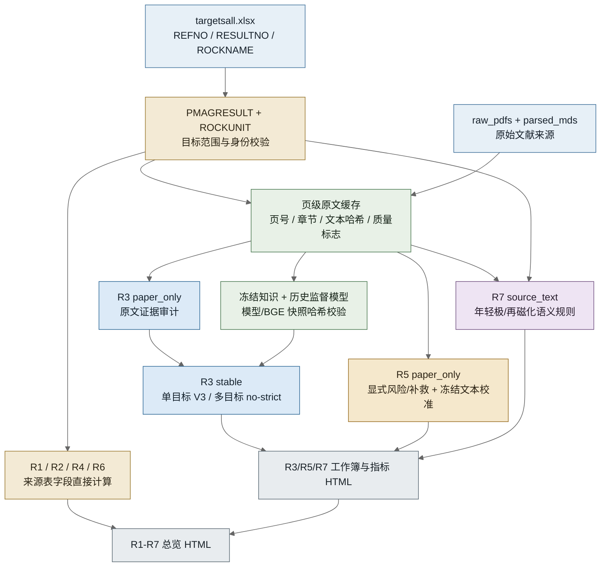
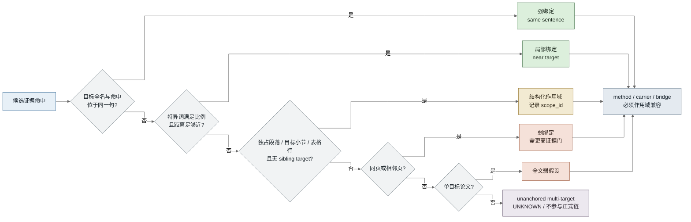
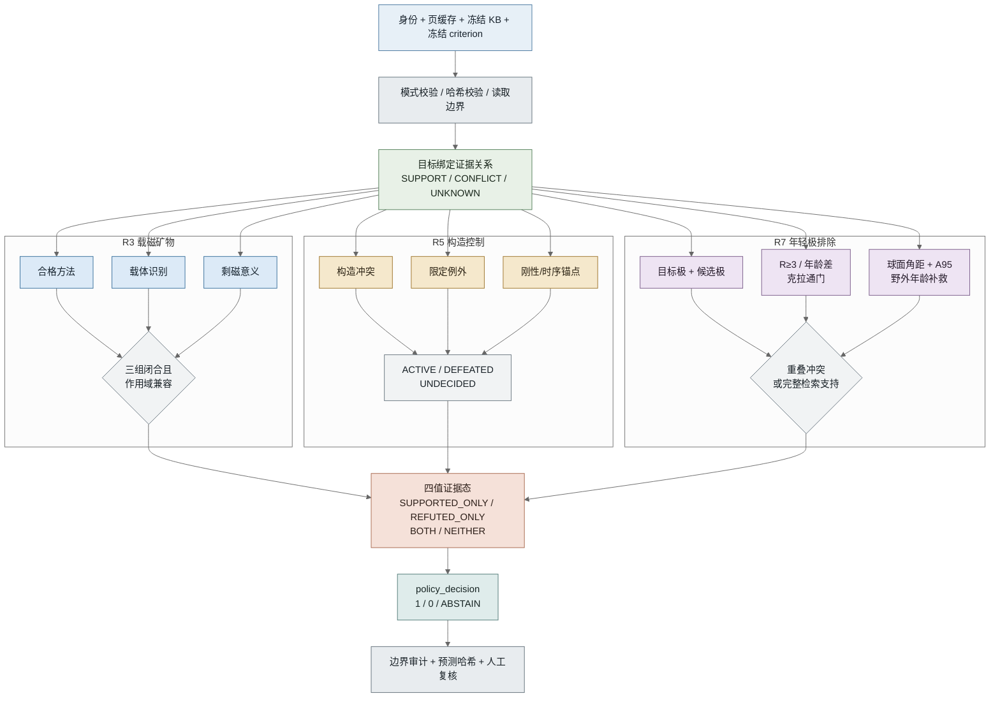

# R3/R5/R7 判断工作流与技术说明

日期：2026-07-14

> 2026-07-17 更新：当前单目标 V3 的内部 grouped OOF 为 90.02%；单目标 V3
> 与多目标 scope 组合后的稳定全量结果为 84.19%。GREP 50/50 融合的 84.51%
> 因 bootstrap 区间跨 0 未晋升。第 6 节已按当前流程更新，完整口径见
> `docs/current_r3_results_20260717.md`。严格知识评分流没有因此改变。

> 2026-07-22 更新：完整业务入口的 R3 默认已替换为历史监督的全量稳定组合，
> `paper_only` 继续作为证据审计和缺原文回退；84.19% 仍是内部 grouped OOF，
> 不是严格知识流或外部验证精度。

本文只解释当前项目的实际工作流、判定技术、评测技术和已知限制，不讨论专利
写法。为了避免把性质不同的流程混在一起，全文区分：

1. 全目标业务输出流程；
2. 严格专家知识评分流程；
3. R3 训练与 grouped OOF 评测流程。

## 1. 三个指标分别判断什么

### 1.1 R3：载磁矿物或剩磁载体表征

R3 关注论文是否对待评对象的载磁矿物或剩磁载体进行了足够的研究。当前规范
科学头要求一条目标绑定、范围兼容的三段证据链：

```text
合格诊断方法
    AND 载磁矿物或载体识别
    AND 载体对被评剩磁的意义解释
```

方法证据包括 IRM/SIRM、Lowrie、热磁或 Js-T、磁滞、FORC、矫顽力、显微镜、
SEM/TEM/EDS、EPMA、XRD 等；载体证据包括 magnetite、hematite、pyrrhotite 等；
意义桥接需要说明某矿物承载某剩磁/磁化分量，或者该载体支持原生、次生、蚀变
或再磁化解释。

### 1.2 R5：构造校正和古水平面控制

R5 关注待评方向是否具有足够的构造背景和古水平面控制。项目不是简单地把
“tilt correction”或“positive fold test”视为必然合格，而是区分：

- 正向锚点：克拉通刚性、变形后侵入体等；
- 辅助支持：构造校正、未变形、小倾角、野外检验；
- 冲突：外来地体、内部旋转、缺失古水平面、需要但未校正、倾角压扁缺少佐证；
- 可撤销例外：只击败明确声明可被该例外解除的冲突。

### 1.3 R7：年轻参考极或年轻叠加排除

R7 关注待评古地磁极是否可能与更年轻的可靠参考极重合，或者是否存在年轻再磁化
解释。严格定量路径需要目标极和候选极的坐标、A95、年龄、时期、可靠度 R、稳定
相连克拉通以及野外年龄约束；缺少正式字段时保持未知。

## 2. 项目中实际存在的三条流程

| 流程 | 入口 | 是否使用标签 | 是否使用 PMAGRESULT/ROCKUNIT | 用途 |
| --- | --- | --- | --- | --- |
| 全目标业务流 | `run_r1_r7_workflow.sh` | R3 模型编码历史标签；当前运行不读取标签 | 会用于目标预检、R1/R2/R4/R6 和默认 R7，不作为 R3 在线特征 | 生成统一 R1-R7 工作簿、JSONL 与 HTML |
| 严格知识流 | `run_strict_knowledge_workflow.sh` | 评分阶段不使用 | 不使用 | 研究无表专家知识冲突检测 |
| R3 grouped OOF | `experiment_r3_all_labelled_pdf_grouped_oof.py` | 每折训练区使用 R3 标签 | 不作为模型运行特征 | 评估原文特征对历史 R3 标签的泛化能力 |

这三条流程不能互换表述。业务流的结果最完整，但不是严格无表；严格流的数据
边界最强，但会产生大量 ABSTAIN；OOF 流有训练和标签，只用于方法开发评测。

## 3. 全目标业务流

执行 `run_r1_r7_workflow.sh` 时，默认参数为：

```text
targets       = data/targetsall.xlsx
R3 profile    = supervised_stable / stable_production_v1
R5 profile    = paper_only
R7 profile    = source_text
```

### 3.1 图 1：全目标业务工作流



### 3.2 目标范围预检

编排器首先用 PMAGRESULT 的 RESULTNO/ROCKUNITNO 与 ROCKUNIT 的 REFNO/ROCKNAME
建立预期目标集合，再与 `targetsall.xlsx` 对齐。它检查：

- RESULTNO 是否唯一且非空；
- ROCKUNITNO、REFNO、ROCKNAME 是否一致；
- 全目标模式是否遗漏或增加 RESULTNO；
- 声明为无标签的输入是否意外包含 R1-R7 列。

这一步能防止目标错位，但也意味着整个业务编排器读取了来源表。

### 3.3 页缓存构建

`build_r3_page_source_cache.py` 按 REFNO 读取现有 Markdown/文本或 PDF 文本层，生成
JSONL 页缓存。每条记录包含来源类型、PDF/解析路径、页数、文本长度、质量标志，
以及每一页的页号、正文、章节提示和文本哈希。

当前全标签 R3 评测使用融合缓存：主缓存覆盖 1,457 篇有文本论文，另有 21 篇
主缓存为空的论文由 MinerU 缓存恢复，因此 1,478 篇本地 PDF 全部获得非空正文。

### 3.4 R3 业务分支

业务流先从目标文件生成临时三列身份清单，然后运行
`build_r3_paper_only_predictions.py` 保留科学证据。主要步骤为：

1. 按 REFNO 取得论文页缓存；
2. 为同一论文建立完整 sibling target 集合；
3. 检索 method、carrier、diagnostic、bridge 候选；
4. 排除参考文献噪声、否定载体、未实施方法和非结果型诊断词；
5. 选择页距不超过 1 且作用域兼容的 method-carrier-bridge 组合；
6. 检查目标绑定、身份歧义和来源质量；
7. 输出二元兼容值、条件状态、证据引文和人工复核标志。

随后 `build_r3_stable_production_predictions.py` 从论文全文、冻结知识概念和 BGE
查询检索特征构造模型输入。单目标记录叠加 knowledge/fulltext V3，多目标记录使用
稳定 `no-strict` 基础融合。模型只在本地 PDF 和非空页文本同时存在时评分；否则
保留 `paper_only` 分数并写入 `FALLBACK_TO_PAPER_ONLY`。严格知识流仍把证据不足
保留为 ABSTAIN，后者更适合无标签科学冲突解释。

### 3.5 R5 业务分支

R5 `paper_only` 由两层共同决定：

1. 确定性原文规则：检索目标绑定的构造风险和补救证据；高置信风险链可直接翻转
   为 R5=0，风险与补救并存时触发人工复核；
2. 冻结文本校准：对目标中心原文构造 binary word、相邻 bigram 和通用 R5 pattern
   特征，目标名称被替换为 `TARGETTERM`，再用冻结 Bernoulli-presence 线性参数
   计算 risk score 并与冻结阈值比较。

校准产物的训练采用按 REFNO 隔离的哈希划分和五折 OOF 阈值选择。运行时产物不
包含 REFNO/RESULTNO 答案查找，也不读取 PMAGRESULT/ROCKUNIT，但它仍是使用历史
R5 标签离线拟合的监督模型。

### 3.6 R7 业务分支

默认 `source_text` 是较宽松的兼容路径：

- 基线为 R7=1；
- 原文中出现与当前目标绑定的年轻极、再磁化或年轻叠加规则时翻转为 0；
- 使用来源元数据辅助上下文；
- 来源缺失时仍保留兼容值 1，但标记人工复核。

该路径不是完整的 A95/APWP 数值比较。严格定量路径位于 strict workflow，当前
冻结参考极目录为空，因此不能把业务 R7=1 解释为已经完成所有年轻参考极排除。

## 4. 共同技术前端：原文解析、检索和目标绑定

### 4.1 多解析器质量门

MinerU 不是默认覆盖全部 PDF，而是风险触发的候选解析器。质量仲裁比较：

- 非空页数和规范化字符数；
- CID/乱码和来源风险标志；
- 段落边界、结构化页和表格行恢复；
- IRM、磁滞、热磁、显微等领域关键词覆盖；
- R3 核心方法、载体和桥接概念是否保留。

页级融合遵循“同一物理页只选一个完整来源”，不会把 pypdf 和 MinerU 的文本直接
拼接。这样可以避免拼接出原文不存在的句间关系。

### 4.2 冻结检索模式

`paper_text_retrieval.py` 使用可审计的模式库检索 R3/R5 候选。R3 包含：

- 方法：IRM、热磁、磁滞/FORC、显微与矿相分析等；
- 诊断结果：带场强的不饱和/饱和、Curie 温度数值、SD/PSD/MD、磁滞比值、
  Verwey/Morin 转变；
- 载体：具体磁性矿物和 magnetic/remanence carrier；
- 桥接：矿物与 remanence、ChRM、component、primary/secondary origin 的关系。

诊断词只有在带结果语气、量值或状态时才进入诊断候选。例如“用于测定 Curie
temperature”不等同于论文已经报告 Curie 温度结果。

### 4.3 图 2：目标作用域绑定层级



### 4.4 同名多记录歧义

当同一 `REFNO + canonical ROCKNAME` 对应多个 RESULTNO，而身份清单没有磁化
分量、方向、样品组或表格行定位符时，系统无法证明文献证据属于哪一条记录。
严格流应输出 `IDENTITY_AMBIGUOUS/ABSTAIN`。这是当前多目标文献准确率显著低于
单目标文献的主要原因。

## 5. 严格专家知识评分流

### 5.1 四项输入

严格评分只允许：

1. 三列身份清单；
2. 与身份 REFNO 集合完全一致的原文页缓存；
3. `r357_expert_kb_v1.json`；
4. `r357_criterion_spec_v2.json`。

知识库加载器拒绝答案映射、记录标识和未披露标签监督。评分前后计算四项输入
哈希；R3、R5、R7 在三个新的空写目录中分别执行；子评分进程禁止网络和未声明
文件读取。

### 5.2 图 3：严格 R3/R5/R7 并行推理



### 5.3 证据态与判决态不是同一概念

| 活动支持 | 活动冲突 | `evidence_status` | 可能的策略判决 |
| --- | --- | --- | --- |
| 有 | 无 | `SUPPORTED_ONLY` | 支持组完整时为 1，否则 ABSTAIN |
| 无 | 有 | `REFUTED_ONLY` | 冲突满足策略时为 0 |
| 有 | 有 | `BOTH` | 冲突优先为 0，或按指标策略 ABSTAIN |
| 无 | 无 | `NEITHER` | ABSTAIN |

这个设计避免把“存在一些支持词”直接等同于合格，也避免把支持和冲突同时出现的
论文压缩成一个无法解释的单值。

### 5.4 R7 定量公式

目标极与候选极的大圆角距为：

```text
d = arccos(sin(phi_t)sin(phi_c)
          + cos(phi_t)cos(phi_c)cos(lambda_t-lambda_c))
```

若 `d <= A95_target + A95_candidate`，两置信包络按包含边界的规则重叠。只有候选
满足 R≥3、同一稳定相连克拉通且年轻超过一个正式地质时期时，重叠才有资格形成
冲突。当前 KB 的 reference_poles 为空、qualified_search_manifest 为空，因此
该引擎已实现，但知识数据尚不足以形成高覆盖率 R7 定量判断。

## 6. R3 训练与评测流

### 6.1 训练的含义

这里的“训练”不是训练 PDF 解析器，也不是把 PMAGRESULT 表复制到输出。它是：

1. 用原文和冻结知识生成 351 维、无标签特征；
2. 按 REFNO 把 1,478 篇论文分成五折；
3. 每次用四折 R3 标签拟合分类器；
4. 对完全未参与该次拟合的一折论文产生预测；
5. 五次组合后，每个目标恰好获得一次 OOF 预测。

351 维基础特征由知识/文本工程特征和论文整理风格特征拼接而成，四个 combined
专家为 HistGradientBoosting、RandomForest、ExtraTrees 和 LogisticRegression。
在此基础上，当前单目标 V3 继续融合 V4 目标上下文、查询自适应检索、原文风格
知识专家和完整论文词级专家；全量 evaluator 对单目标行使用 V3，对多目标行使用
scope 模型，并单独评估 GREP 融合是否达到稳定晋升条件。

### 6.2 图 4：R3 grouped OOF 评测设计

```mermaid
%%{init: {"theme": "neutral", "flowchart": {"curve": "basis", "nodeSpacing": 30, "rankSpacing": 44}}}%%
flowchart LR
    A["3,173 个有标签目标<br/>1,627 篇论文"]:::input
    B{"有本地 PDF?"}:::gate
    C["2,751 行<br/>1,478 篇论文"]:::source
    X["422 行无 PDF<br/>跳过且不计入分母"]:::skip
    F["351 维无标签特征<br/>标签打开前冻结"]:::feature
    G["五个 REFNO 分组折<br/>论文零交叉"]:::fold
    M["基础四模型 OOF<br/>HGB / RF / ET / LR"]:::model
    V["V4 目标上下文 + 查询检索<br/>原文风格知识特征"]:::feature
    S["单目标 V3<br/>完整论文词级专家"]:::model
    D["多目标 scope<br/>目标作用域特征"]:::model
    O["预测回执<br/>哈希固定"]:::output
    E["稳定全量组合<br/>84.19%"]:::metric
    Q["GREP 50/50 探索<br/>84.51%，未晋升"]:::selective

    A --> B
    B -- 是 --> C --> F --> G --> M --> V
    V --> S --> O
    V --> D --> O --> E
    B -- 否 --> X
    D -. "同折 GREP 概率融合" .-> Q

    classDef input fill:#e7f0f7,stroke:#44749d,color:#17212b;
    classDef gate fill:#f1f3f4,stroke:#68757e,color:#182026;
    classDef source fill:#e8f1e7,stroke:#4f7c55,color:#18251a;
    classDef skip fill:#ece8ef,stroke:#75677d,color:#251f29;
    classDef feature fill:#f3ead5,stroke:#9b7a32,color:#2b2415;
    classDef fold fill:#dceaf7,stroke:#336c99,color:#16232e;
    classDef model fill:#eee4f3,stroke:#765786,color:#261c2b;
    classDef output fill:#e8ecef,stroke:#5f6d77,color:#182026;
    classDef metric fill:#dfeceb,stroke:#4d7774,color:#182524;
    classDef selective fill:#f5e1d9,stroke:#a6664c,color:#2c1e18;
```



### 6.3 当前结果如何理解

| 范围 | 正确率 | 覆盖率 | 含义 |
| --- | ---: | ---: | --- |
| 单目标 V3 | 90.02% | 100% | 当前单目标正式内部 OOF 结果 |
| 全量稳定 scope + V3 | 84.19% | 100% | 当前稳定全量组合 |
| 全量 GREP 50/50 探索 | 84.51% | 100% | 两折回退且 bootstrap 区间跨 0，不晋升 |

这些结果不能写成严格无标签业务效果。单目标达到 90% 不代表多目标和全量达到
90%；84.51% 也只能作为内部探索上限，不能替代稳定的 84.19%。

### 6.4 为什么必须按 REFNO 分组

同一论文通常对应多个 RESULTNO。如果随机按行切分，论文的一部分行可能进入训练，
另一部分进入测试，模型会看到相同的标题、写作风格、段落和实验描述，导致明显
的数据泄漏。按 REFNO 分组保证整篇论文只能出现在训练侧或测试侧。

OOF 的作用是让训练集中的每一行都获得一次“该论文未参与拟合”的预测，从而
能够比较模型、分析错误和研究阈值。但五折全部属于同一开发数据范围，所以仍然
不是新的外部文献验证。

## 7. 当前最关键的技术点

### 7.1 数据面隔离

严格流将身份、原文、知识、criterion 与标签评测物理分开，并用读取守卫和哈希
审计验证。这是项目区别于简单表格复现的重要技术基础。

### 7.2 页级单源解析仲裁

解析器不是字符越多越好。系统要求页界可靠、领域概念不丢失，并在结构或文本
质量上有实际提升；同一页只保留一个来源，避免伪造跨解析器上下文。

### 7.3 目标和证据作用域

项目把证据从“论文级命中”进一步约束到同句、独占段落、目标小节和表格行，
并记录 scope_id 和竞争目标。这是处理多目标文献的核心，但当前 component-level
定位仍不完整。

### 7.4 可撤销冲突和四值状态

系统不采用简单多数投票。冲突只能被预先声明的特定例外击败，并且支持与冲突
可以共同保留为 BOTH，最终再由指标策略决定 0 或 ABSTAIN。

### 7.5 监督融合稳定性

候选融合必须在外层测试标签不可见时完成，并用按 REFNO 聚类的配对 bootstrap
检查增益。聚合正确数更高但折间回退、置信区间跨 0 的候选只保留为探索结果。

## 8. 当前瓶颈和改进优先级

1. **多目标归属。** 61 篇混合 R3 标签论文的 278 行正确率只有 48.20%；58 篇
   被模型全部预测成同一值，说明模型主要看见论文级信号。
2. **缺 component manifest。** 需要从原文表格、分量名称、方向、pole 和样品组
   建立到 RESULTNO 的可追踪映射。
3. **R5 校准泛化。** R5 冻结文本模型的历史 held-out 增益较小，当前产物自身也
   建议只作为 shadow/AB candidate，仍需新的外部 REFNO 集验证。
4. **R7 知识数据。** 推理公式和门控已实现，但合格参考极目录尚未填充。
5. **业务流与严格流差异。** 当前一键业务流仍使用来源表完成部分指标和 R7；
   若最终目标是完全无表 R357，需要把 strict profile 变成独立的一键输出入口。

## 9. 代码与产物索引

| 模块 | 代码或产物 |
| --- | --- |
| 全目标公开入口 | `run_r1_r7_workflow.py`（内部兼容编排器为 `run_r357_latest_full_workflow.py`） |
| 严格编排 | `run_r357_strict_knowledge_workflow.py`、`strict_scoring_worker.py` |
| 页缓存 | `build_r3_page_source_cache.py`、`build_r3_mineru_page_cache.py` |
| 检索与目标绑定 | `paper_text_retrieval.py` |
| 专家冲突引擎 | `expert_conflict_engine.py` |
| R3 业务判断 | `build_r3_paper_only_predictions.py`（审计/回退）、`build_r3_stable_production_predictions.py`（默认最终分数） |
| R5/R7 业务判断 | `build_r5_r7_source_recovered_predictions.py` |
| R7 定量提取和推理 | `r7_original_text_extractor.py`、`r7_pole_overlap_reasoner.py` |
| 严格边界审计 | `audit_r357_scoring_boundary.py` |
| R3 基础全量 OOF | `experiment_r3_all_labelled_pdf_grouped_oof.py` |
| R3 单目标 V3 | `evaluate_r3_fulltext_fusion_single872_oof_v3.py` |
| R3 全量融合 | `evaluate_r3_scope_fusion_all_oof_v1.py` |
| R3 调权稳健性 | `experiment_r3_single872_base_weight_nested_oof_v1.py` |
| 当前 R3 结果说明 | `docs/current_r3_results_20260717.md` |
