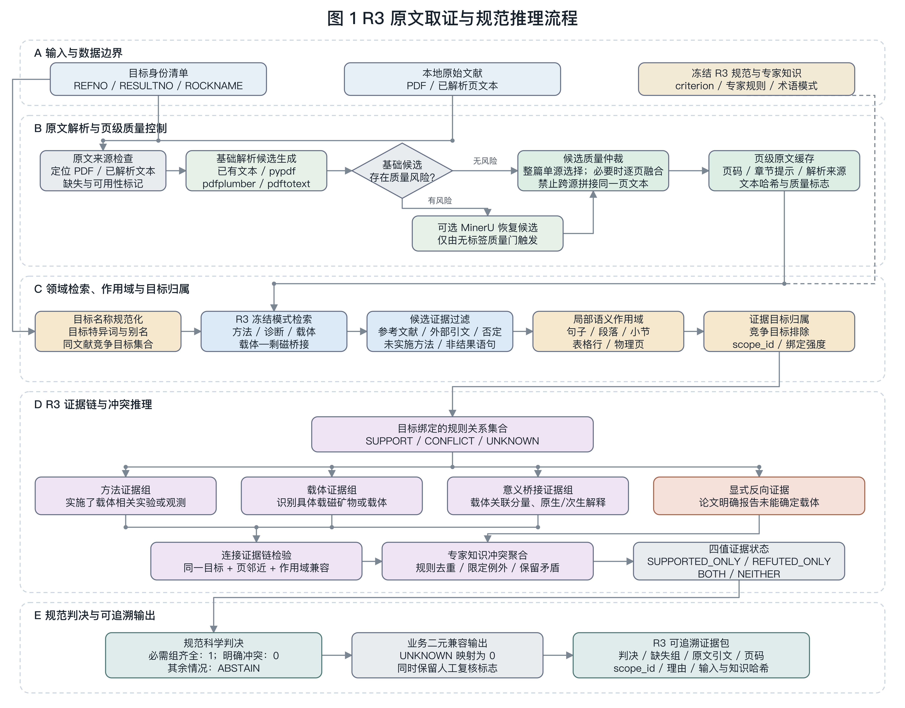
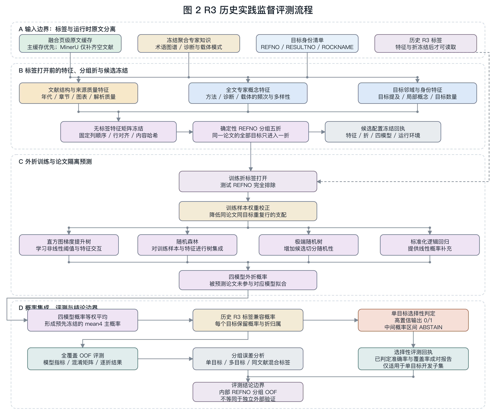

# R3 完整判断流程、技术选择与参考依据

日期：2026-07-14

本文只说明当前项目中 R3 的完整判断流程和技术依据，不列样本量、准确率、
概率阈值或其他评测数值。文中把三类容易混淆的结果严格分开：

1. **规范科学头**：判断论文是否完成了“合格载体研究、载体识别、剩磁意义解释”；
2. **历史实践头**：判断原文是否包含能够合理形成历史 `ROCKMAG` 描述的研究片段；
3. **监督评测头**：用历史 R3 标签训练模型，验证原文特征对历史标签的泛化能力。

规范科学头和历史实践头回答的不是同一个问题。监督评测头也不是专家规则本身，
而是开发期的统计验证工具。

2026-07-22 起，一键业务流程默认先生成 `paper_only` 证据链，再由历史监督的全量
稳定模型产生最终 R3 分数；单目标走 V3，多目标走 `no-strict`，缺原文特征时回退
到 `paper_only`。这不改变严格知识流的数据边界。

> 2026-07-17 状态：当前单目标监督评测入口为 V3，全覆盖内部 OOF 为 90.02%；
> 全量稳定组合为 84.19%。本文重点解释技术流程，不把监督评测数字当作严格知识
> 评分效果。结果口径见 `docs/current_r3_results_20260717.md`。

## 1. R3 到底判断什么

R3 的科学对象不是“论文有没有出现 magnetite、IRM 或 Curie temperature”，而是：

> 对指定 `RESULTNO` 对应的岩石、样品组或磁化分量，论文是否通过合格的岩石
> 磁学、矿物学或显微方法研究了载磁矿物，并解释这些载体对待评剩磁的意义。

当前冻结规范将其形式化为：

```text
目标可归属
AND 合格载体研究
AND 载体识别或明确报告合理但未定的识别结果
AND 载体证据的剩磁意义解释
```

“意义解释”包括原生或次生性质、CRM/DRM/TRM 成因、蚀变、后期叠加、倾角变浅、
磁化分量归属及相应构造解释。单独出现方法名或矿物名不足以满足规范科学头。

## 2. 分拆后的科研流程图

### 2.1 原文取证与规范推理

这一部分只展示运行时原文获取、解析质量控制、领域检索、目标归属、证据链、
冲突推理和规范判决，不包含历史标签训练。



可编辑版本：[SVG](figures/r3-original-evidence-normative-workflow.svg)。固定栅格布局由
`scripts/render_r3_workflow_figures.cjs` 生成。

### 2.2 历史实践监督评测

这一部分只展示无标签特征冻结、REFNO 分组、训练折标签读取、异质模型、OOF、
概率集成、选择性拒判、误差分析和外部验证边界。



可编辑版本：[SVG](figures/r3-supervised-evaluation-workflow.svg)。固定栅格布局由
`scripts/render_r3_workflow_figures.cjs` 生成。

## 3. 逐流程技术解释

### 3.1 定义目标身份和数据边界

**操作目标**：每一条待判断记录，而不是整篇论文。

**具体操作**：只用 `REFNO` 定位论文，用 `RESULTNO` 保持输出对齐，用
`ROCKNAME` 在原文中建立目标锚点。同一篇论文的其他目标被建立为 sibling target，
用于检测证据是否可能属于竞争对象。

**采用技术**：最小身份清单、运行时数据面隔离、输入哈希和模式校验。

**选择原因**：`REFNO` 只能说明证据来自哪篇论文，不能说明证据属于论文中的哪条
结果。保留 `RESULTNO` 是为了追踪记录，但不能把它当作文本特征。最小身份清单还
能阻止 `PMAGRESULT.ROCKMAG` 或旧 R3 答案被意外读入严格评分。

**参考依据**：这一层主要是可复现性和数据泄漏控制的工程设计，不是古地磁实验
方法。其审计思想与 W3C PROV 的来源追踪原则一致，但当前实现是项目自定义的文件
哈希、读取边界和回执协议，并非完整实现 PROV-O。

### 3.2 定位原始文献并执行来源门

**操作目标**：目标 `REFNO` 对应的本地 PDF 或已解析文本。

**具体操作**：检查是否存在可用原文。无 PDF 的目标不进入 PDF 原文评测分母；在
严格科学判断中，无原文不能被解释为“不合格”，而应保持未知或跳过。

**采用技术**：来源可用性门、缺失数据显式状态。

**选择原因**：检索不到证据与论文没有证据是两件不同的事。把无 PDF 直接编码成
负类会混淆“数据缺失”和“科学证据反驳”。

### 3.3 生成多个 PDF 解析候选

**操作目标**：PDF 中的正文、物理页边界、段落和表格结构。

**具体操作**：基础候选可来自已有解析文本、pypdf、pdfplumber 和 pdftotext。
pdfplumber 会检测明显双栏正文并按列恢复阅读顺序。只有在无文本、正文过短、
CID/乱码、结构扁平或领域概念缺失等风险触发时，才调用 MinerU 生成版面感知候选。

**采用技术**：多解析器候选生成、风险触发的版面感知解析。

**选择原因**：旧论文的扫描质量、字体编码、双栏版式和表格结构差异很大，不存在
对所有 PDF 都最优的单一解析器。MinerU 成本更高，也可能丢失基础解析器已经保留
的领域词，因此不应无条件覆盖全部文献。

**参考依据**：MinerU 的解析能力参考 Wang 等的 *MinerU: An Open-Source
Solution for Precise Document Content Extraction*，arXiv:2409.18839。项目只借用
其文档解析器，不采用论文中的任何 R3 判断逻辑。

### 3.4 进行物理页级单源质量仲裁

**操作目标**：同一物理页的基础解析文本和 MinerU 候选文本。

**具体操作**：比较非空内容、字符量、乱码、段落边界、表格行、解析置信信息以及
IRM、热磁、磁滞、显微、载体和载体-剩磁联系等关键概念是否保留。最终每个物理页
只选择一个完整来源。

**采用技术**：无标签质量门、领域保持约束、页级 late selection。

**选择原因**：直接拼接两个解析器会把两个不同阅读顺序的片段放在一起，可能伪造
原文不存在的共现和证据链。页级单源选择保留了上下文完整性，同时允许不同页面
使用不同解析器。

**参考依据**：这是本项目针对证据关系抽取设计的保守仲裁策略。MinerU 文献支持
版面解析能力，但“物理页单源融合”和“领域概念不得回退”是项目自己的约束。

### 3.5 建立页级原文缓存和来源追踪

**操作目标**：仲裁后的每一页正文。

**具体操作**：保存物理页号、解析来源、正文、章节提示、页面文本哈希、整体缓存
哈希和质量标志。

**采用技术**：page-aware cache、内容寻址哈希、证据 provenance。

**选择原因**：后续每个判断必须能够回到具体页码和原始引文；哈希用于证明判断前后
输入没有变化，也使缓存可以重复使用而不需要反复解析 PDF。

### 3.6 构建 R3 专家知识

**操作目标**：需要从原文寻找的岩石磁学方法、诊断结果、载磁矿物和意义关系。

**具体操作**：当前知识分为三层：

- 规范 criterion：来自用户上传的 R3 判据文字，不使用历史标签；
- 标签无关术语图谱：离线统计 `ROCKMAG` 中的聚合术语类型，不保留记录标识、原始
  字段值或答案映射；
- 历史实践知识：只用于监督开发头，由训练分区的历史 R3/ROCKMAG 聚合得到，运行时
  不允许查找原表中的当前行。

**采用技术**：专家本体式术语分类、冻结正则模式、离线知识蒸馏、运行时边界隔离。

**选择原因**：旧数据库使用大量缩写，例如 IRM、Js-T、HYST、OP、SEM。这些缩写
是有效检索入口，但数据库字段不能成为运行时答案表。将它们转换成去标识化概念族，
可以利用历史专家经验，同时保留从原文重新取证的要求。

**参考依据**：知识内容的地学依据来自上传判据及其所列文献。历史实践知识不是
独立科学规范，因此必须标记为 supervised calibration，不能反过来改写规范结论。

### 3.7 规范化目标名称并建立竞争目标

**操作目标**：`ROCKNAME` 以及同一 `REFNO` 下的其他 `ROCKNAME`。

**具体操作**：进行 Unicode 归一化、大小写折叠、标点和空白归一化、常见词与特异
词拆分，并生成精确短语和 token 组合。对每篇论文同时保存所有 sibling target。

**采用技术**：实体规范化、别名匹配、竞争实体集合。

**选择原因**：旧论文名称可能带地层、地区、岩性和时代修饰，也可能因连字符或
字符编码不同而无法精确匹配。只做全文字符串相等会丢失召回；只看通用词又会把
同一论文中的多个对象混在一起。

**参考依据**：与文档级关系抽取任务中“实体跨句出现、关系必须绑定到正确实体对”
的问题相似，可参考 Yao 等的 DocRED 工作作为任务背景。当前实现不是 DocRED 模型，
而是为小样本、强可解释场景编写的确定性绑定器。

### 3.8 冻结模式检索四类证据

**操作目标**：页缓存中的句子、局部段落和表格行。

**具体操作**：检索四类候选：

- 方法：IRM/SIRM、三轴 IRM、低温 IRM、热磁或磁化率-温度、磁滞、FORC、AMS、
  AIR、AAR、显微、矿相和矿物分离等；
- 诊断结果：饱和/不饱和行为、带单位的矫顽力或场强、Curie/Verwey/Morin 转变、
  磁滞参数和 SD/PSD/MD 等；
- 载体：magnetite、hematite、maghemite、pyrrhotite、greigite、goethite 等；
- 桥接：某载体承载某剩磁或磁化分量，并支持原生、次生、蚀变、CRM、DRM、叠加
  或再磁化解释。

**采用技术**：领域词典、规则检索、单位和结果语气约束。

**选择原因**：R3 语料规模有限，术语高度专业且可枚举。规则检索可以直接展示
命中的原文和触发原因，比端到端黑箱抽取更容易由古地磁专家审查和修改。

**参考依据**：

- Lowrie (1990) 支持三轴 IRM 通过矫顽力和解阻温度识别铁磁性矿物；
- Day, Fuller & Schmidt (1977) 支持用磁滞参数研究粒度和磁畴状态；
- Pike 等 (1999) 与 Roberts, Pike & Verosub (2000) 支持 FORC 对混合磁性组分、
  switching field 和相互作用场的识别；
- Dunlop & Özdemir (1997) 为岩石磁学方法和矿物性质提供综合基础；
- 上传判据还列出低温 IRM、AMS/AIR/AAR、反射光、SEM/TEM 和矿物分离的原始文献。

这些文献用于证明“为什么某类实验可以成为 R3 证据”，不是用于证明“出现关键词
即可自动合格”。

### 3.9 过滤无效或误导性命中

**操作目标**：初步检索得到的每一条候选证据。

**具体操作**：识别并排除：

- 参考文献列表和 DOI 附近的书目信息；
- “某作者曾使用该方法”这类外部研究引文；
- 否定的矿物识别；
- 计划、建议、可能使用但未实际实施的方法；
- 普通退磁温度区间被误当作矿物学诊断；
- 只有“测量 Curie temperature”目的语气、却没有报告结果的句子；
- 不带方法、诊断或剩磁归属关系的裸矿物名。

**采用技术**：章节截断、书目噪声检测、否定检测、实施语气识别、结果自证门。

**选择原因**：高召回关键词检索会把方法背景、参考文献和实验计划混入结果。R3 的
核心不是“概念被提到”，而是“目标材料上实际完成了可以解释载体的研究”。

### 3.10 建立句子、段落、小节和表格作用域

**操作目标**：有效候选周围的最小语义范围。

**具体操作**：优先提取完整句子；若页面保留段落边界，则建立段落 scope；若命中
位于表格行，则建立表格行 scope；同时记录章节提示和页级位置。每个 scope 生成稳定
的 `scope_id`。

**采用技术**：局部 discourse scope、结构化表格行作用域、可追踪 scope 标识。

**选择原因**：方法、矿物和意义可能分布在相邻句中，单句太窄会漏掉真实关系；
整页或全文又太宽，会把不同目标的证据错误连接。段落、小节和表格行提供了介于
单句与全文之间的可解释作用域。

### 3.11 把证据绑定到具体目标

**操作目标**：候选 scope 与待评 `ROCKNAME/RESULTNO` 的归属关系。

**具体操作**：按以下优先级判断：

1. 目标全名与证据位于同一句；
2. 目标特异 token 与证据在局部范围内共同出现；
3. 证据位于目标独占段落、小节或表格行，且没有 sibling target；
4. 证据只在同页或邻近页出现，作为弱绑定；
5. 单目标论文允许全文弱归属；
6. 多目标论文无法排除竞争目标时，标记为未锚定或身份歧义。

**采用技术**：分层 entity grounding、竞争目标否决、强弱绑定等级。

**选择原因**：当前主要科学风险不是“找不到岩石磁学词”，而是“找到的证据属于
论文中的另一个对象或磁化分量”。对多目标论文禁止全文传播，可以减少把论文级
证据复制给所有 RESULTNO 的系统性误判。

### 3.12 构建连接证据链

**操作目标**：同一目标下的方法、载体和意义候选。

**具体操作**：搜索目标一致、页邻近且 scope 兼容的组合。诊断结果用于证明方法
确实产生了载体信息；某些明确的“component carried by hematite”句子可以同时完成
载体识别和意义桥接。普通退磁方法不能替代独立载体表征。

**采用技术**：约束式关系组合、局部证据图、连接链排序。

**选择原因**：三个关键词各自在全文出现不代表它们构成同一科学论证。连接约束
要求证据在局部上下文中能够共同解释同一目标，避免跨章节或跨目标拼接。

**参考依据**：科学链本身直接来自上传的 R3 criterion：必须合理尝试识别载体并
评论其意义。关系组合的具体页距、scope 兼容和排序规则是项目工程实现。

### 3.13 建立支持、冲突和未知关系

**操作目标**：证据链以及显式反面陈述。

**具体操作**：合格方法、载体和桥接进入 `SUPPORT`；明确声明无法识别载体等规则
进入 `CONFLICT`；来源不足、目标未绑定、规则条件不完整或限定关系无法确定时进入
`UNKNOWN`。同一规则的重复片段只保留最强且可追踪的一项，避免重复引用被当成
多份独立证据。

**采用技术**：规则级关系图、去重、显式未知、限定式冲突。

**选择原因**：科学文献中“没有检索到”不能自动成为反证；重复描述也不是独立
实验。三类关系比简单关键词计数更接近专家审查过程。

### 3.14 专家冲突聚合和四值证据状态

**操作目标**：同一目标的全部活动支持、冲突和未知关系。

**具体操作**：先应用规则中预先声明的限定例外，再对每条规则保留最强关系，最后
分别累计支持质量、冲突质量、未知质量和未消解矛盾。证据状态保留为：仅支持、
仅反驳、支持与反驳并存、两者均无。

**采用技术**：defeasible reasoning、未归一化合取证据质量、四值状态。

**选择原因**：通用支持不能随意抵消明确冲突；同时出现支持和冲突时也不能用多数
投票压成一个值。保留矛盾可以让专家看到冲突来自哪些原文片段。

**参考依据**：四值表达在概念上可参考 Belnap (1977) 对 true、false、both 和
neither 的区分；证据质量组合与 Dempster-Shafer 证据理论有亲缘关系。当前公式是
项目自定义的“保留 contradiction 的未归一化合取组合”，不是 Belnap 逻辑或标准
Dempster 规则的逐字实现。

### 3.15 规范科学头作出严格判决

**操作目标**：冻结 criterion 的三个必需组。

**具体操作**：只有目标绑定的合格方法、载体识别和意义解释全部成立时，输出科学
合格。明确且未被规则允许例外击败的冲突可输出不合格。任一必需组仍未知、支持与
冲突并存或身份歧义时输出拒判。

**采用技术**：三值逻辑 criterion、必需组闭合、拒判而非强制二值化。

**选择原因**：规范 R3 的核心是完整科学论证。检索沉默和链条不完整不等于论文
明确失败，因此严格流必须保留拒判。

**参考依据**：直接依据上传的 Reliability Criterion 3.3。其历史基础来自 Van der
Voo (1990) 的古地磁数据可靠性框架；方法和意义要求由上传的修订判据进一步展开。

### 3.16 业务兼容适配

**操作目标**：需要固定二元列的现有工作簿接口。

**具体操作**：将规范判断适配为二元兼容列，同时另外保存 `outcome`、缺失条件、
来源质量、引文和 `manual_review`。无原文或证据冲突时，二元列可能仍有兼容占位，
但 `outcome` 必须保持 UNKNOWN。

**采用技术**：decision adapter、双层输出语义。

**选择原因**：旧接口需要二元字段，而科学推理需要未知和拒判。把兼容列与科学
状态分开，可以维持下游程序，同时避免把占位值误当作确定结论。

### 3.17 历史 ROCKMAG 实践头

**操作目标**：判断原文能否合理形成历史数据库中的 ROCKMAG 风格描述。

**具体操作**：实践头接受三条替代路径：实施了合格表征方法；报告了能够自证实验
已完成的诊断结果；明确把载体归因到剩磁或磁化分量。它不强制每条历史阳性记录都
具备完整规范三段链。

**采用技术**：dual-head criterion、历史语义校准、离线监督知识蒸馏。

**选择原因**：历史标签更接近“ROCKMAG 字段是否有可填写内容”，与现代规范
criterion 并不完全一致。强行用规范三段链拟合历史标签会产生系统性语义错位；
反过来用历史字段定义科学 R3 又会降低科学标准。因此保留两个头并报告冲突最合理。

**参考依据**：实践头的术语族来自 `ROCKMAG` 聚合统计，属于本项目历史数据校准，
不是独立发表的地学判据。其科学可接受方法仍受上传 criterion 及岩石磁学文献约束。

### 3.18 无标签特征工程

**操作目标**：监督评测头需要的每条目标特征。

**具体操作**：在打开当前折标签之前，从原文生成：

- 目标局部和全文的知识概念出现、存在性和多样性；
- 方法、诊断、载体及其局部共现；
- 目标出现次数、同文献目标数、共享证据迹象；
- 页数、章节、图表、参考文献比例、解析来源和文本质量；
- 发表年代和版式/整理风格等 curation 特征。

**采用技术**：专家知识特征、局部/全文双尺度表示、对数计数、文档版式元特征。

**选择原因**：知识特征表达“论文做了什么”，局部特征表达“是否靠近目标”，版式
特征补偿不同年代论文对实验的书写和结构差异。

**重要限制**：发表年代、期刊族和版式可能学习到数据库整理历史或报告习惯，而非
纯粹的 R3 科学因果关系。它们适合历史标签兼容模型，不应作为规范科学头的证据。

### 3.19 按论文分组的 OOF 训练

**操作目标**：历史标签监督模型的泛化评测。

**具体操作**：先冻结特征和论文分组，再打开训练折标签。任何一篇论文的全部
RESULTNO 必须一起进入训练侧或测试侧。每一折在其他论文上拟合，在被排除的论文上
产生预测；合并后每条记录获得一次排除自身论文的 OOF 预测。

**采用技术**：grouped cross-validation、out-of-fold prediction、训练前冻结回执。

**选择原因**：同一论文中的多个结果共享标题、正文、版式和实验描述。如果按行
随机切分，模型会在训练中见过测试论文，得到虚高结果。按 `REFNO` 分组才模拟预测
一篇新论文。

**参考依据**：可参考 Roberts 等 (2017) 关于具有层级依赖结构数据应采用 blocked
cross-validation 的讨论。这里的层级单位是论文 `REFNO`。

### 3.20 多模型集成

**操作目标**：冻结特征矩阵的历史 R3 概率预测。

**具体操作**：分别训练梯度提升树、随机森林、极端随机树和逻辑回归，再对它们的
概率进行等权融合。

**采用技术**：异质模型 ensemble、概率平均。

**选择原因**：树模型擅长非线性阈值和特征交互；逻辑回归提供线性、稳定的补充。
等权平均不需要再用测试标签训练一个元模型，能降低单个模型的方差和偶然偏差。

**参考依据**：Friedman (2001) 对梯度提升，Breiman (2001) 对随机森林，Geurts、
Ernst 与 Wehenkel (2006) 对极端随机树提供算法基础。当前参数、特征和等权融合是
本项目配置，不是这些论文实验的直接复现。

### 3.21 选择性判定和人工复核

**操作目标**：监督实践头产生的概率以及严格头的未知/矛盾状态。

**具体操作**：高置信负向或高置信正向才自动决定；中间不确定区间输出 ABSTAIN。
严格头出现来源风险、身份歧义、链条缺项、跨 scope 连接或支持/冲突并存时，也进入
人工复核队列。

**采用技术**：selective classification、reject option、human-in-the-loop。

**选择原因**：项目的实用目标不是强制自动覆盖所有记录，而是在保证已决定结果
可靠性的同时，将真正需要地学判断的对象交给专家。

**参考依据**：拒判思想可追溯到 Chow (1970) 对 recognition error 与 reject 的
权衡。当前拒判区间来自项目开发数据，仍需要独立外部文献验证，不能视为普适常数。

### 3.22 输出证据包和审计回执

**操作目标**：每条 R3 决定及其可复核依据。

**具体操作**：输出判决、证据状态、缺失组、命中规则、页码、原文引文、scope_id、
目标绑定强度、来源质量、人工复核标志、输入哈希、知识库哈希和预测回执。

**采用技术**：evidence pack、machine-readable provenance、reproducibility receipt。

**选择原因**：R3 不是普通文本分类任务。专家必须能够从结果追溯到原文页和规则，
也必须能够证明运行时没有读取当前行 ROCKMAG 或旧答案。

## 4. 参考文献与它们在系统中的角色

| 参考 | 在 R3 中的角色 | 是否直接实现其算法 |
| --- | --- | --- |
| Van der Voo (1990), *The reliability of paleomagnetic data*, Tectonophysics, DOI: 10.1016/0040-1951(90)90116-P | 可靠性判据的历史基础 | 否；项目使用上传的修订 R3 文本进行形式化 |
| 用户上传的 Reliability Criterion 3.3 | 定义规范 R3 的方法、识别和意义要求 | 是规范来源，被形式化为冻结 criterion |
| Lowrie (1990), DOI: 10.1029/GL017i002p00159 | 三轴 IRM、矫顽力和解阻温度的矿物识别依据 | 只实现术语和证据模式，不复现实验 |
| Day, Fuller & Schmidt (1977), DOI: 10.1016/0031-9201(77)90108-X | 磁滞参数和磁畴/粒度解释依据 | 同上 |
| Pike et al. (1999), DOI: 10.1063/1.370176 | FORC 方法基础 | 同上 |
| Roberts, Pike & Verosub (2000), DOI: 10.1029/2000JB900326 | FORC 对天然混合磁性组分的解释依据 | 同上 |
| Dunlop & Özdemir (1997), *Rock Magnetism: Fundamentals and Frontiers* | 磁性矿物、磁畴和岩石磁学综合背景 | 知识参考，不是代码算法 |
| Wang et al. (2024), *MinerU*, arXiv:2409.18839 | 版面感知 PDF 解析器依据 | 使用其解析工具；质量仲裁为项目自定义 |
| Yao et al. (2019), DocRED, ACL | 文档级实体关系和跨句归属的任务背景 | 否；当前是确定性 scope 绑定器 |
| Belnap (1977), DOI: 10.1007/978-94-010-1161-7_2 | 支持、反驳、并存、均无的概念参照 | 否；当前四值状态为项目实现 |
| Roberts et al. (2017), DOI: 10.1111/ecog.02881 | 层级依赖数据的分组/阻塞交叉验证依据 | 使用相同原则，分组单位为 REFNO |
| Friedman (2001), DOI: 10.1214/aos/1013203451 | 梯度提升模型基础 | 使用 sklearn 实现 |
| Breiman (2001), DOI: 10.1023/A:1010933404324 | 随机森林基础 | 使用 sklearn 实现 |
| Geurts et al. (2006), DOI: 10.1007/s10994-006-6226-1 | 极端随机树基础 | 使用 sklearn 实现 |
| Chow (1970), DOI: 10.1109/TIT.1970.1054406 | 不确定样本拒判的理论背景 | 使用拒判思想；区间为项目开发配置 |

引用这些文献有四个目的：

1. 证明哪些实验和结果具有识别载磁矿物的科学意义；
2. 固定 criterion 的来源，避免用评测结果随意改变科学定义；
3. 说明 PDF 解析、分组评测、模型集成和拒判机制为何合理；
4. 明确区分“参考其思想”“调用其工具”和“直接复现其算法”。

不能把上述引用统称为“全部来自顶会”。R3 的科学基础主要来自地球物理和岩石
磁学期刊、专著及判据论文；机器学习部分来自统计学、机器学习期刊和会议；目标
绑定、页级单源仲裁、双头 criterion、读边界和审计回执则主要是本项目的工程设计。

## 5. 当前最需要继续完善的技术

1. **component manifest**：从表格行、样品组、磁化分量、方向和 pole 描述建立到
   `RESULTNO` 的可追踪映射；
2. **段落与表格结构恢复**：提高旧 PDF 中 scope 边界的可靠性；
3. **桥接关系抽取**：加强“矿物-分量-原生/次生意义”的句法和共指识别；
4. **规范头与实践头联合报告**：不再只给单一 R3 值，而是同时报告科学规范结论、
   历史兼容结论和二者冲突；
5. **独立外部验证**：冻结全部模型、知识和拒判策略后，用全新 REFNO 文献验证。

## 6. 代码映射

| 流程 | 代码或知识产物 |
| --- | --- |
| 基础页缓存 | `scripts/build_r3_page_source_cache.py` |
| MinerU 候选与页级仲裁 | `scripts/build_r3_mineru_page_cache.py` |
| 检索、过滤、scope 和目标绑定 | `scripts/paper_text_retrieval.py` |
| R3 业务兼容判断 | `scripts/build_r3_paper_only_predictions.py` |
| 专家关系与冲突聚合 | `scripts/expert_conflict_engine.py` |
| 规范 criterion | `data/knowledge/r357_criterion_spec_v2.json` |
| 无表专家知识库 | `data/knowledge/r357_expert_kb_v1.json` |
| 标签无关 ROCKMAG 术语图谱 | `data/knowledge/r3_rockmag_lexicon_v1.json` |
| 历史监督 ROCKMAG 知识 | `data/calibration/r3_positive_rockmag_expert_kb_v2.json` |
| 基础分组 OOF | `scripts/experiment_r3_all_labelled_pdf_grouped_oof.py` |
| 单目标 V3 | `scripts/evaluate_r3_fulltext_fusion_single872_oof_v3.py` |
| 全量 scope/GREP 融合 | `scripts/evaluate_r3_scope_fusion_all_oof_v1.py` |
| 三部分比例稳健性 | `scripts/experiment_r3_single872_base_weight_nested_oof_v1.py` |
